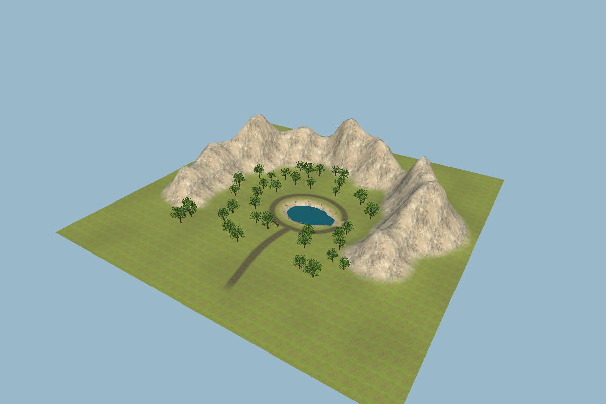

<div align="center">

# 🌿 Terrain Lab

### Sculpt a landscape. Paint a world. Step inside it.

A hands-on Unity terrain workshop for the **Unity Authorized Educator Program · 2026**.


[**Start the workshop**](#-get-started) · [**Teacher script**](Docs/TerrainClassroom.md) · [**Explore the scenes**](#-two-scenes-one-learning-journey)

[**Download the student Unity Package (28.4 MB)**](https://github.com/Omar-Makhlouf/Unity-Authorized-Educator-Program-Session-2026/raw/refs/heads/main/Downloads/TerrainLab-Students.unitypackage)



*From an empty scene to a landscape you can explore.*

</div>

## 🏞️ Two scenes, one learning journey

| Start with a blank canvas | Explore the finished example |
| --- | --- |
| **TerrainClassroom** | **TerrainFinalized** |
| Empty environment with a prepared player capsule and sun; no Terrain object. | C-shaped mountains, rocky slopes, painted trees, a pond, a reusable bench, and walkable paths. |
| Create your own Terrain, configure its height, reset its position, and build your landscape. | Inspect how the pieces fit together, then explore from eye level. |
| [Open scene](Assets/Scenes/TerrainClassroom.unity) | [Open scene](Assets/Scenes/TerrainFinalized.unity) |

Both scenes use the same first-person player prefab. Students create new TerrainData in the starter; the finished TerrainData stays independent. The finished Terrain is positioned at **(0, 0, 0)** with an **80-metre height range** and a clearing around **Y=12**.

## ✨ What you'll build and learn

- **Create the ground** — add a Terrain, change its height range, use Set Height → Flatten All, then reset its Transform position to (0, 0, 0).
- **Shape the land** — raise hills, lower valleys, and smooth a C-shaped mountain border.
- **Paint the surface** — blend grass, dirt, sand, and rock using photographic textures and normal maps.
- **Grow a landscape** — paint and erase trees using a registered oak prefab and Terrain tree instances.
- **Take the pond challenge** — work out how to build a pond with a safe route out, using the finished example as your reference.
- **Reuse a prop** — inspect and place a wooden bench prefab.
- **Test at eye level** — walk, sprint, jump, and check whether your landscape feels accessible.

The finished example includes **38 painted oaks**, a clear approach path, and a walking loop around the pond. The shared tree prefab has three mesh LODs to reduce geometry at a distance.

## 🚀 Get started

### 1. Import the student package

Students do not need to clone this repository or install Git.

**Download access:** this repository is currently private. Sign in to GitHub with an account that has repository access to use the download link. Teachers can also share `Downloads/TerrainLab-Students.unitypackage` directly; importing the file does not require GitHub access.

1. [**Download TerrainLab-Students.unitypackage**](https://github.com/Omar-Makhlouf/Unity-Authorized-Educator-Program-Session-2026/raw/refs/heads/main/Downloads/TerrainLab-Students.unitypackage). Download this file only; you do not need the repository ZIP.
2. In Unity Hub, create an empty **Universal 3D (URP)** project using **Unity 6000.3.24f1**.
3. Choose **Assets → Import Package → Custom Package**, select the file, and import everything.
4. Open `Assets/Scenes/TerrainClassroom.unity`. The package's `Assets/TerrainLab/START_HERE.md` contains setup notes and the student exercise. The teacher guide stays in this repository at `Docs/TerrainClassroom.md`.

Use a project with **Universal RP** and **Input System** installed (workshop versions: URP **17.3.0**, Input System **1.20.0**). If Input System is missing, install it from **Window → Package Management → Package Manager → Unity Registry** and accept enabling its input backends. Under **Project Settings → Player**, Active Input Handling must be **Input System Package (New)** or **Both**; restart if prompted.

The package includes both scenes, player, input actions, layers, textures, trees, bench, and the student exercise. Teacher instructions are excluded. It uses the destination project's URP setup; it does not install registry packages or replace project settings.

<details>
<summary><strong>For teachers/developers: clone the full source project instead</strong></summary>

Install [Git LFS](https://git-lfs.com/) before cloning so the photographic textures download correctly.

```bash
git lfs install
git clone https://github.com/Omar-Makhlouf/Unity-Authorized-Educator-Program-Session-2026.git
cd Unity-Authorized-Educator-Program-Session-2026
git lfs pull
```

1. Install **Unity 6000.3.24f1** through Unity Hub.
2. Add the cloned project folder and open it.
3. Allow Unity to import assets and resolve the packages in the project manifest.

</details>

### 2. Create your terrain or tour the example

- **For the lesson:** open `Assets/Scenes/TerrainClassroom.unity` and create the ground using the steps below before pressing Play.
- **For a tour:** open `Assets/Scenes/TerrainFinalized.unity`.
- Press **Play**, then click inside the **Game view** to capture the mouse.

In the source project, the finished example is the first enabled scene in Build Settings, followed by the starter scene. Importing the package leaves the destination project's build scene list unchanged; open workshop scenes directly.

### 3. Build the starting ground

Keep Play stopped. In the starter scene:

1. Choose **GameObject → 3D Object → Terrain** and name it **Student Terrain**.
2. In **Terrain Settings**, set Terrain Width and Length to **200**, Terrain Height to **80**, and Heightmap Resolution to **513 × 513**. Terrain Height controls the available vertical range.
3. Choose **Paint Terrain → Set Height**, try Height **20** and **Flatten All**, then change Height to **12** and **Flatten All** again to reset the ground to the lesson's starting level. Do this before sculpting: Flatten All replaces the entire heightmap.
4. Reset the Terrain's Transform, checking Position **X=0, Y=0, Z=0**, Rotation **(0, 0, 0)**, and Scale **(1, 1, 1)**. The ground remains at Y=12 because its heightmap is raised above the Terrain origin.
5. Keep **Classroom Player** at **(100, 12.12, 65)**, just above the ground. Save the scene and project assets. You can now press Play.

The new Terrain starts without paint layers or tree prototypes. Add the supplied Grass, Dirt, and Sand TerrainLayers from `Assets/TerrainClassroom/Layers/`, Rock from `Assets/TerrainFinalized/Layers/`, and register `Assets/TerrainFinalized/Vegetation/ClassroomOak.prefab` with **Paint Trees → Edit Trees → Add Tree**. The [teacher script](Docs/TerrainClassroom.md) walks through these steps. Create fresh TerrainData rather than assigning the old `ClassroomTerrain.asset`.

The starter has no floor until you create one; pressing Play beforehand makes the capsule fall and respawn.

### For teachers: rebuild the package

Close this project in Unity, then run `powershell -NoProfile -ExecutionPolicy Bypass -File ./Tools/Export-StudentPackage.ps1` from the project folder. The execution-policy override applies only to that process. The script updates `Downloads/TerrainLab-Students.unitypackage` using the current saved workshop assets and student exercise, excluding teacher instructions. Pass `-UnityPath` if your Editor is installed elsewhere. Commit the updated package with its source changes so the download stays current. Temporary export logs remain in the ignored `Exports/` folder.

## 🎮 Explore with keyboard and mouse


| Input | Action |
| --- | --- |
| **W A S D** / **Arrow keys** | Walk and strafe |
| **Mouse** | Look around |
| **Left Shift** | Sprint |
| **Space** | Jump |
| **Escape** | Release the cursor and suspend movement/look |
| **Left-click Game view** | Capture the mouse again |
| **R** | Return to spawn |

**Edit in the Scene view with Play stopped. Explore in the Game view with Play running.** If you sculpt over the spawn area, move **Classroom Player** above the new ground before testing again.

## 👩‍🏫 A ready-to-teach, 30-minute workshop

The [**complete teacher script**](Docs/TerrainClassroom.md) includes spoken prompts, demonstrations, student exercises, checkpoints, troubleshooting, and exit questions.

| Time | Activity |
| --- | --- |
| 00:00–03:00 | Tour the finished environment |
| 03:00–09:00 | Create Terrain, set/reset height, and reset its Transform |
| 09:00–13:00 | Sculpt a mountain border |
| 13:00–17:00 | Add layers and paint grass, paths, and rock |
| 17:00–21:00 | Register a tree prefab, paint, and erase trees |
| 21:00–23:00 | Set the pond challenge and inspect a bench prefab |
| 23:00–28:00 | Walk through the landscape and improve one thing |
| 28:00–30:00 | Review, save, and answer exit questions |

Have each student import the package into their **own Universal 3D project**. Duplicating a scene alone still shares its TerrainData; for independent work in one project, duplicate the TerrainData and assign it to both the Terrain and TerrainCollider.

<details>
<summary><strong>What students start with</strong></summary>

The Hierarchy contains **Sun** and **Classroom Player** (including its camera and capsule body). Students create the Terrain, its paint layers, and tree palette during the lesson. No pond, terrain, or props are pre-placed.

</details>

## 🧭 Find your way around the project

| Location | Contents |
| --- | --- |
| `Downloads/TerrainLab-Students.unitypackage` | Student download; import into a new Universal 3D (URP) project |
| `Assets/TerrainLab/START_HERE.md` | Student setup and exercise included in the package |
| `Assets/Scenes/` | Starter and finished teaching scenes |
| `Assets/Player/` | Shared capsule player prefab and material |
| `Assets/Scripts/ClassroomFirstPersonController.cs` | Input, movement, gravity, mouse look, and respawn |
| `Assets/TerrainClassroom/` | Reusable surface layers and an unused legacy TerrainData asset; students create fresh TerrainData |
| `Assets/TerrainFinalized/` | Finished terrain, materials, textures, and props |
| `Assets/TerrainFinalized/Vegetation/` | Paintable oak prefab and three mesh LODs |
| `Assets/TerrainFinalized/Prefabs/ParkBench.prefab` | Reusable bench |
| `Docs/TerrainClassroom.md` | Full teacher script and classroom reference |

### A few useful teaching details

- Painted trees live in **TerrainData**, rather than appearing as individual Hierarchy objects.
- The pond is a **heightmap depression**, with ground at the bottom. It does not use the Terrain Paint Holes tool.
- Water is a simple visual plane; there is no swimming system. Walk out using the east-side ramp or press **R**.
- The oak uses mesh LODs of **12,204 → 4,532 → 1,840 triangles**. It has a trunk collider, without wind animation or a distant billboard.
- The player uses the project's **Input System** actions and a **CharacterController**.

## ✅ Validation

Earlier checks covered the shared player's walking, sprinting, jumping, mouse look, cursor release, and respawning, plus collision checks of the finished entrance, pond loop, and east basin exit. After the lesson update, saved scene checks verify the empty starter, player references, finished terrain at the origin, and aligned pond and props. The starter requires student-created ground before movement can be tested.

These are Editor and focused Play mode checks. A standalone build and a classroom hardware performance benchmark have not been run.

The student package was exported using Unity 6000.3.24f1. Archive checks confirm the saved assets match this repository, required project references are included, and teacher notes are excluded. Importing into a fresh URP project has not yet been tested.

## 📸 Texture credits

Photographic terrain textures come from [Poly Haven](https://polyhaven.com/) under its [CC0 asset license](https://polyhaven.com/license):

[Leafy Grass](https://polyhaven.com/a/leafy_grass) · [Brown Mud 02](https://polyhaven.com/a/brown_mud_02) · [Rock Boulder Dry](https://polyhaven.com/a/rock_boulder_dry) · [Sand 01](https://polyhaven.com/a/sand_01)

The tree and bench were created locally for this workshop. The CC0 statement above applies to the credited Poly Haven assets.

---

<div align="center">

**Build the landscape. Walk the route. Teach the process.**

[Open the teacher script →](Docs/TerrainClassroom.md)

</div>
